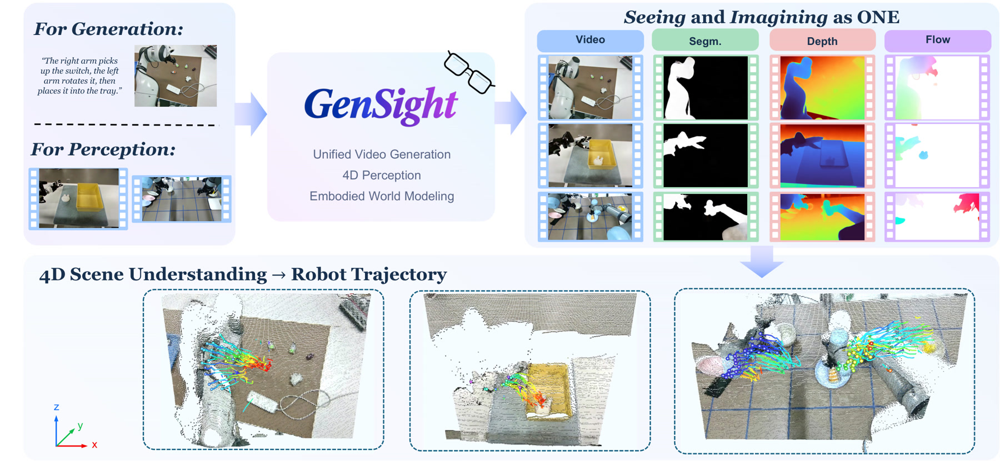
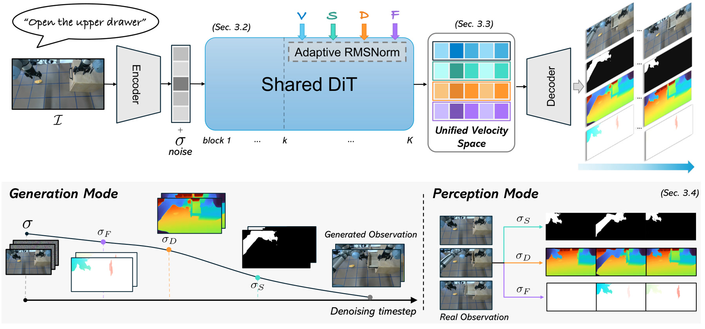
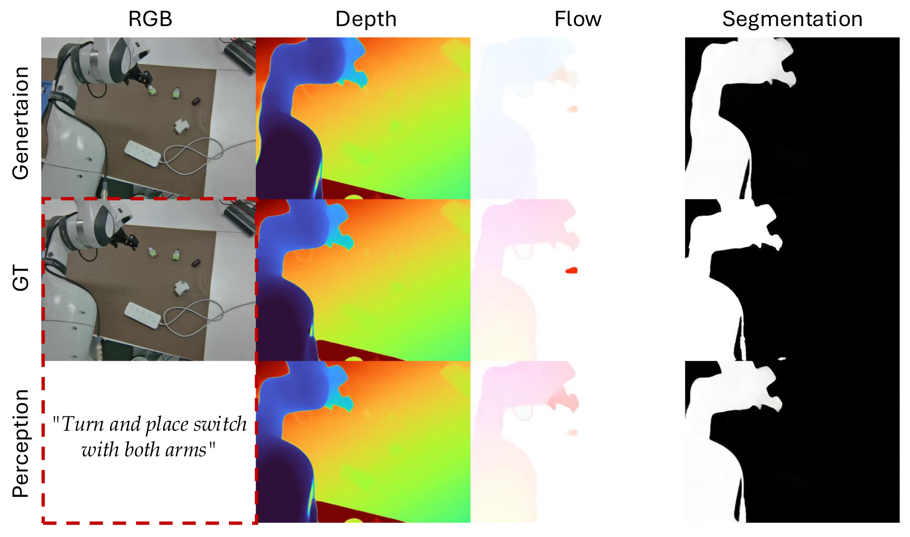
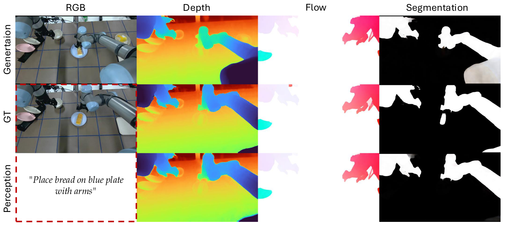
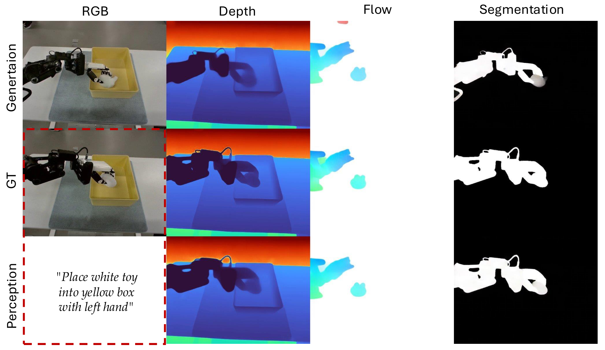
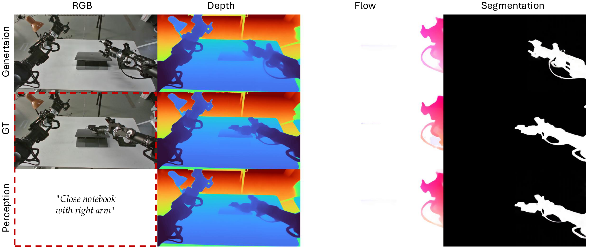

<div align="center">

# GenSight

### Seeing and Imagining as One: Unified Video Generation and 4D Perception for Embodied World Modeling

[](https://gensight-rbs.github.io/)
[](#)



</div>


---

## Abstract

Embodied world models should not only imagine plausible futures, but also perceive the
geometric, semantic, and motion structure of the evolving world. We present **GenSight**,
a unified embodied world model that brings future video generation and dense perception
into a single pretrained video diffusion transformer. GenSight uses a unified
spatiotemporal representation for video, depth, embodiment segmentation, and
first-frame-relative 2D flow. Built on a shared DiT backbone, GenSight uses lightweight
task modulation to predict all modalities within the same architecture. All tasks are
jointly optimized within a unified velocity prediction space. At inference, GenSight
supports two complementary modes: **multi-step future video generation** with aligned
dense predictions and **single-step dense perception** from an observed video. By
unifying modality representation, model architecture, and prediction space, GenSight
avoids separate modality-specific pipelines and couples appearance, geometry, semantics,
and motion in a shared representation. It promotes cross-modal consistency and allows
dense perception to benefit from the spatiotemporal priors learned through video
generation.

## Overview

<div align="center">

</div>


## Qualitative Results

GenSight jointly produces future RGB video with aligned depth, embodiment segmentation,
and 2D/3D flow across diverse robot embodiments. Each figure shows the generated RGB,
depth, flow, and segmentation (top) alongside ground truth and single-step perception.

**Franka**

<div align="center"></div>

**UR5**

<div align="center"></div>

**Tianyi**

<div align="center"></div>

**Tienkung (humanoid)**

<div align="center"></div>

## Quantitative Results

### Generation mode

**Text-image-to-video generation on RoboMIND and RoboTwin 2.0.** 49-frame TI2V generation
conditioned on the initial frame and caption. Metric groups: **Video** (FVD, FID, PSNR,
LPIPS), **Depth** (AbsRel, δ₁), and **2D Flow** (nEPE, AAE<sub>top1%</sub>, EPE). Generated
depth and 2D flow are scored with VGGT-Ω and AllTracker as references. AbsRel and δ₁ are in %;
AAE<sub>top1%</sub> in degrees; EPE in pixels. Best per column in **bold**.

| Method | FVD ↓ | FID ↓ | PSNR ↑ | LPIPS ↓ | AbsRel ↓ | δ₁ ↑ | nEPE ↓ | AAE<sub>top1%</sub> ↓ | EPE ↓ |
| :-- | :--: | :--: | :--: | :--: | :--: | :--: | :--: | :--: | :--: |
| *RoboMIND* | | | | | | | | | |
| Wan2.2-I2V-A14B | 69.37 | 50.01 | 17.13 | 0.3083 | – | – | – | – | – |
| Cosmos3-Nano | 44.97 | 42.09 | 16.90 | 0.3002 | – | – | – | – | – |
| RynnWorld4D | 73.45 | 47.90 | **18.07** | 0.2661 | 8.53 | 92.55 | 1.133 | 45.14 | **4.936** |
| **GenSight** | **14.55** | **16.12** | 18.01 | **0.2296** | **7.88** | **93.17** | **0.427** | **23.10** | 7.089 |
| *RoboTwin 2.0* | | | | | | | | | |
| RynnWorld4D | 71.18 | 67.65 | 16.53 | 0.3839 | **4.86** | 95.69 | 1.225 | 47.49 | **7.11** |
| **GenSight** | **61.14** | **46.28** | **16.71** | **0.2927** | 4.98 | **97.25** | **0.892** | **26.78** | 16.45 |

### Perception mode (RoboMIND)

With ground-truth RGB video as input, GenSight is compared against task-specific foundation
models for embodiment segmentation, depth, and scene flow.

**(a) Embodiment segmentation**

| Method | IoU ↑ |
| :-- | :--: |
| SAM 3 | 73.5 |
| GenCeption | 67.5 |
| **GenSight** | **88.7** |

**(b) Depth** — RMSE in cm, AbsRel and δ₁ in %.

| Method | RMSE ↓ | AbsRel ↓ | δ₁ ↑ |
| :-- | :--: | :--: | :--: |
| VDA | 13.12 | 7.4 | 94.0 |
| DA3 (mono) | 15.65 | 13.2 | 81.7 |
| DA3 (stream) | 16.17 | 13.2 | 85.3 |
| DVD | 15.91 | 7.6 | 92.9 |
| VGGT-Ω | 13.11 | 5.9 | 94.5 |
| GenCeption | 15.89 | 8.5 | 90.7 |
| **GenSight** | **4.76** | **2.4** | **99.1** |

**(c) Scene flow** — 2D EPE in pixels; 3D ADE/FDE reported as absolute / displacement.
RAFT† and RAFT‡ share the 2D EPE; their 3D scores use ground-truth and GenSight's predicted
depth, respectively.

| Method | EPE ↓ | ADE (abs/disp) ↓ | FDE (abs/disp) ↓ |
| :-- | :--: | :--: | :--: |
| RAFT† | 11.2 | 7.04 / 6.88 | 7.49 / 7.40 |
| RAFT‡ | 11.2 | 9.63 / 7.68 | 9.95 / 7.92 |
| Any4D | 18.4 | 15.26 / 6.72 | 16.93 / 7.97 |
| V-DPM | 25.2 | 24.17 / 4.88 | 26.24 / 7.14 |
| Track4World | 6.8 | 20.31 / 6.92 | 23.99 / 9.06 |
| **GenSight** | **5.2** | 7.39 / 7.68 | 9.51 / 9.87 |

## Citation

```bibtex
@misc{feng2027gensight,
  title  = {Seeing and Imagining as One: Unified Video Generation and 4D Perception for Embodied World Modeling},
  author = {Haitang Feng and Zhuoman Liu and Zhennan Wang and Sheng Wang and Juelin Li and Chengzhi Zhao and Hexiang Wei and Lin Shao},
  year   = {2027}
}
```
